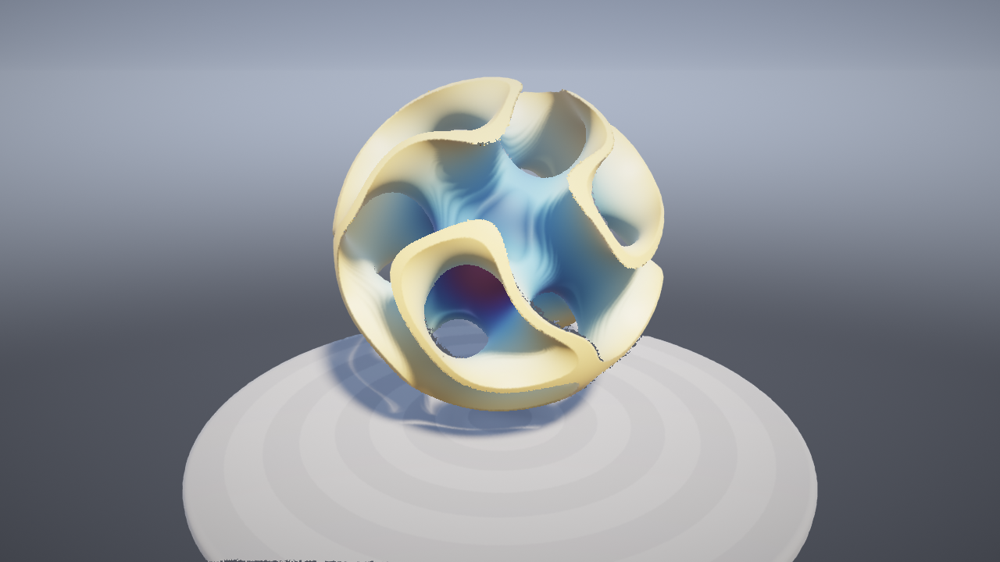
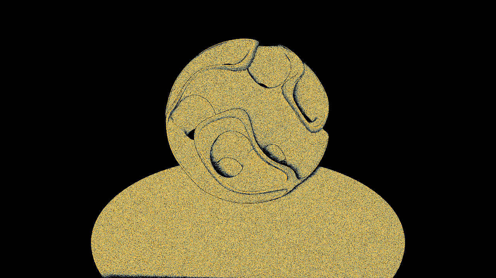

# Swarm

A renderer for implicit surfaces with no triangles and no per-pixel rays.
The scene is a signed distance field; the image is made by a few million
particles that live on its surface and are steered by feedback from the image
they just produced.

Rust core (zero dependencies) + WebGPU compute shaders, running in the browser.

**[Live demo](https://samg-coder.github.io/swarm/)** (needs a browser with WebGPU)

## The idea

Ray marchers pay per pixel; rasterizers need a mesh. Swarm does neither:

1. **Simulate** (compute, one thread per particle). Each particle
   - reads *last frame's* depth and density buffers to learn whether the image
     used it and how crowded its pixel was,
   - migrates if it was hidden, back-facing, off-screen or surplus: it jumps
     next to a visible particle, into the emptiest nearby pixels,
   - rides along with moving geometry (it compares the field now with the field
     a moment ago and follows the surface point that kept its normal),
   - falls back onto the surface with Newton steps along the SDF gradient,
   - shades itself: soft shadows, ambient occlusion, specular, fog,
   - writes its depth: `atomicMax` of `1/z` per pixel, 2x2 footprint.
2. **Splat colour** (compute). Particles on the front-most surface `atomicAdd`
   their colour and a count. The count is next frame's density feedback.
3. **Resolve** (one fullscreen draw). Averages each pixel, fills pixels that
   have depth but no sample from same-surface neighbours, composites over sky.

Most of step 1 changes slowly, so the swarm takes turns. In any one frame a
quarter of the particles do all of it; the rest only follow their surface (one
gradient, one Newton step) and write their depth, keeping the colour they
have. The turns go by whole workgroups, not by particle: a GPU runs
neighbouring threads in lockstep, so work is only saved when all of them skip
it together. Particle order has nothing to do with position, so every pixel
still gets fresh samples every frame. One step is only enough while the
surface moves a little per frame, so the core watches the frame rate: below
about 45 fps the followers take two steps, and below 20 every particle goes
back to doing everything, every frame.

Consequences:

- Sampling follows the image. Whatever the camera looks at collects the whole
  particle budget within a few frames; nothing is spent on hidden surface.
  The "Density view" button shows this (samples per pixel):

  

- Shading cost depends on the particle count, not the resolution, and a
  particle is shaded once in four frames.
- The frame budget is a single number. The core measures frame time and
  shrinks or grows the active particle count to hold the frame rate.
- Shapes can change freely. The scenes animate and cross-fade into each other
  by blending their distance fields; the swarm just flows to the new surface.

Individually these ingredients have relatives (compute point rasterization,
particle sampling of implicit surfaces, object-space shading). The combination,
closed into an image-feedback loop, is what is new here. It is an experiment,
not a replacement for a production renderer: see Limits.

## Build and run

Needs Rust and a browser with WebGPU (current Chrome, Edge or Safari; Firefox where WebGPU is enabled).

    ./build.sh
    python3 -m http.server -d web 8080      # then open http://localhost:8080

Controls: drag to orbit, wheel or pinch to zoom, `1` to `4` scenes, `space`
scene tour, `D` density / depth views. `?n=8000000` sets the particle budget
(2M by default, up to 16.7M if the GPU allows 256 MB buffers).

## GitHub Pages

`.github/workflows/pages.yml` tests the core, builds `swarm.wasm` and deploys
the `web/` folder to GitHub Pages on every push to `main`. In the repository
settings, set Pages > Source to "GitHub Actions" once.

## Architecture

    src/cmd.rs        GPU command stream (the only "binding" to WebGPU)
    src/renderer.rs   resources, frame graph, feedback tuning, adaptive budget
    src/camera.rs     orbit camera, view-projection matrix
    src/lib.rs        C ABI exported from WASM
    src/bin/trace.rs  native tool: record the command stream to a file
    shaders/*.wgsl    common, scene (SDFs + lighting), 3 passes
    web/host.js       executes the command stream (about 130 lines)
    web/main.js       WebGPU setup, input, frame loop, trace replay
    tools/shoot.py    replay a trace in headless Chrome and save the image

The Rust core never calls WebGPU directly. It appends compact commands
(create buffer, create pipeline, compute pass, ...) to a `Vec<u32>`, and
allocates all object ids itself, so the stream is write-only. The JS host
decodes it once per frame. That gives one WASM/JS crossing per frame, a
`.wasm` with no imports, and no bindings crate.

It also makes the renderer testable without a browser build: a native binary
records the same stream to a file and the page replays it.

    cargo test
    cargo run --release --bin trace -- web/trace.bin 960 540 524288 40 0
    python3 tools/shoot.py web/trace.bin out.png   # needs Playwright + Chrome
    # or open http://localhost:8080/?trace=trace.bin

Trace arguments: `width height particles frames scene debug fps`. Scene `12`
starts in scene 1 and morphs to scene 2 halfway through.

## Adding a scene

Write a distance function in `shaders/scene.wgsl`, add it to `scene_sdf` and
`scene_albedo`, and bump `SCENE_COUNT` / `SCENE_NAMES` in `src/renderer.rs`.
Keep the field roughly distance-like (scale it down if gradients exceed 1) so
shadows and the surface projection stay stable. Anything that depends on time
but not on position (orbit centres, rotations) belongs in `scene_at`, which
runs once per particle instead of once per distance evaluation.

## Limits

- Thin features and fast motion can outrun the swarm for a few frames and
  show small holes, more so at low particle counts.
- Edges are aliased where a feature is about one pixel wide.
- Surfaces are opaque. No transparency, reflections or global illumination.
- Scenes are distance fields written in WGSL, not meshes.
- Shading and visibility lag by up to three frames, which shows as a brief
  softness in fast-moving shadows and highlights.
- Every particle still evaluates the scene a few times per frame; cost grows
  with scene complexity.
